# 📼 Documento Técnico Integral — Mixtape (Hi-Fi Cassette & Vinyl PWA)

**Proyecto:** Mixtape — Reproductor Musical Analógico Hi-Fi de los Años 80  
**Ruta del Proyecto:** `D:\REPRODUCTOR MUSICA`  
**Repositorio y Despliegue:** `https://github.com/mixtape-player/Mixtape` (GitHub Pages PWA)  
**Versión Actual:** v2.6.4  
**Plataformas Soportadas:** iOS (iPhone / iPad), Android, Windows y macOS  

---

## 1. Visión General y Stack Tecnológico

**Mixtape** es una Aplicación Web Progresiva (*PWA*) de reproducción musical con arquitectura **Local-First + Cloud Sync** que recrea con fidelidad física y acústica un equipo de alta fidelidad (*Hi-Fi Stereo Cassette Receiver & Turntable*) de 1984, combinándolo con streaming sin anuncios ni límites comerciales, recomendaciones inteligentes, generación de sesiones por ritmo (RPM/BPM), modo infantil blindado, control de licencias por hardware, reanudación automática de cintas interrumpidas y sincronización multi-dispositivo en tiempo real mediante código QR con escáner de cámara optimizado.

### 1.1. Stack Principal (`package.json`)
* **Frontend Framework:** React 19 (`^19.3.1`) + TypeScript (`~7.0.2`).
* **Bundler & Servidor de Desarrollo:** Vite 8 (`^8.3.6`) con middleware personalizado para búsqueda profunda y `vite-plugin-pwa` (`^2.0.0`) con Workbox.
* **Estilos y Diseño Visual:** Tailwind CSS v4 (`@tailwindcss/vite ^4.3.5`) + CSS personalizado con variables dinámicas, texturas metálicas cepilladas y animaciones físicas (`src/index.css`).
* **Almacenamiento Local Multi-Capa:** `localStorage`, `IndexedDB` (mediante `idb ^8.0.4`) y `CacheStorage` API.
* **Sincronización en la Nube:** Motor en tiempo real sin configuración basado en Server-Sent Events (`SSE`) + REST con cifrado simétrico por clave de cinta (`TAPE-XXXX-XXXX`) y soporte opcional para Firebase Firestore (`firebase ^13.3.0`).
* **Iconografía:** `lucide-react` (`^1.72.0`) + gráficos vectoriales SVG a medida.
* **Decodificación de Códigos QR:** `jsQR` (`^1.4.0`) + API nativa de plataforma `window.BarcodeDetector`.

---

## 2. Arquitectura del Sistema y Flujo de Componentes

```mermaid
flowchart TD
    subgraph UI["Capa de Interfaz Hi-Fi (React 19)"]
        Home["HomeTab\n(Recomendaciones & Canales)"]
        Search["SearchTab + RadioTunerDial\n(Búsqueda Continua & Dial FM)"]
        Library["LibraryTab + CassetteRack\n(Cintas, Progreso & Filtro RPM)"]
        CoverFlow["VinylCoverFlow & VinylRecordCard\n(CoverFlow 3D, Inercia Ilimitada & 3 Vinilos/Ala)"]
        BPMGen["RpmPlaylistGenerator\n(33⅓, 45, 78 RPM & Cadencia)"]
        PlayerUI["MiniPlayer & FullScreenPlayer\n(Controles Mecánicos & Pitch)"]
        Deck["RetroTapeDeck\n(Casette, Vinilo, Vúmetros & Bolígrafo)"]
        ResumeModal["ResumeTapeModal\n(Reanudación de Cintas Interrumpidas)"]
        KidsUI["KidsTab & ParentalExitModal\n(Entorno Infantil Seguro)"]
        Modals["AccessGate / AdminLicense / SyncModal / SettingsModal"]
    end

    subgraph Contexts["Capa de Estado Reactivo (Contexts)"]
        AuthCtx["AuthContext\n(Licencias EQ/MX, Trial 1h, SHA-256)"]
        LibCtx["LibraryContext\n(Listas, Favoritos, Ajustes)"]
        PlayerCtx["PlayerContext\n(Cola, Letras, Auto-Deck 3s, Pitch, Progreso Cintas)"]
        KidsCtx["KidsModeContext\n(PIN, Volumen Máx, Sleep Timer)"]
        ThemeCtx["ThemeContext\n(5 Esquemas + Sony Brushed Steel)"]
    end

    subgraph Services["Capa de Servicios y Motores"]
        AudioEng["audioEngine.ts\n(Streaming Híbrido, Anti-Ads, Background Audio, StartTime Seek)"]
        StreamRes["streamResolver.ts\n(Carrera de Nodos Invidious/Piped/Worker/Audius)"]
        TapeProg["tapeProgressService.ts\n(Persistencia de Posición y Reanudación de Cintas)"]
        BpmSrv["bpmService.ts\n(Detección BPM & Generador RPM)"]
        RecSrv["recommendationService.ts\n(Heurística Musical Personalizada)"]
        SyncSrv["syncService.ts + qrCode.ts\n(QR ISO-18004, SSE Real-Time, CRDT Merge)"]
        LyricsSrv["lyricsService.ts\n(LRCLIB Sincronizado)"]
        CacheSrv["cacheService.ts\n(IndexedDB Offline)"]
    end

    UI --> Contexts
    Contexts --> Services
```

### Estructura de Archivos del Proyecto
* **Punto de entrada y configuración:**
  * `index.html` — Cabeceras PWA para iOS/Android (`viewport-fit=cover`, `apple-mobile-web-app-capable`), fuentes *Bebas Neue*, *Oswald*, *Permanent Marker* y *Share Tech Mono*, y carga de YouTube IFrame API.
  * `vite.config.ts` — Plugin de servidor `/api/yt/search` y `/api/yt/releases` para consultas locales y configuración de `VitePWA` / Workbox.
  * `src/main.tsx` — Registro automático del Service Worker con comprobación periódica de actualizaciones al recuperar el foco.
  * `src/App.tsx` — Orquestador de contextos, navegación adaptable (escritorio/móvil), barra superior de estado/sesión y modales globales.
* **Contextos (`src/context/`):**
  * `AuthContext.tsx` — Huella de dispositivo `EQ-XXXX-XXXX`, prueba de 1 hora, validación SHA-256 de licencias `MX-XXXX-XXXX` y panel maestro de administración.
  * `LibraryContext.tsx` — Gestión de listas (*Cintas*), álbumes oficiales (*Vinilos*), ajustes (tamaño de texto, VU meter, modo de apariencia claro/oscuro) y sincronización multi-dispositivo.
  * `PlayerContext.tsx` — Cola de reproducción, control de tiempo, descarga de letras sincronizadas, activación automática de la pletina a los 3 segundos, control de *Pitch* y seguimiento del progreso de cintas activas.
  * `KidsModeContext.tsx` — Estado del modo infantil, PIN parental, limitador de volumen seguro y temporizador de apagado (*Sleep Timer*).
  * `ThemeContext.tsx` — Motor de esquemas de color personalizables combinado con el selector de **Modo Claro (Plata / Aluminio Satinado Hi-Fi)** y **Modo Oscuro (Carbón / Hi-Fi Nocturno)**, con calibración de alto contraste para máxima legibilidad.
* **Servicios (`src/services/`):**
  * `audioEngine.ts` — Motor de audio híbrido (HTML5 `<audio>` + YouTube IFrame API sin cookies), bloqueo de anuncios pre-roll/mid-roll, SponsorBlock, `navigator.mediaSession`, soporte de posicionamiento inicial `startTime` y ancla de audio en segundo plano para móviles con pantalla bloqueada.
  * `streamResolver.ts` — Resolución en carrera paralela (`Promise.any`) contra Cloudflare Worker, nodos Piped e Invidious y red Audius.
  * `youtubeReleaseService.ts` — Extracción de discografías completas y álbumes oficiales de artistas.
  * `tapeProgressService.ts` — Guardado automático y recuperación del punto exacto de escucha de cada cinta.
  * `bpmService.ts` — Base de datos y cálculo determinista de BPM musicales y generador de sesiones por revoluciones ($33\frac{1}{3}$, $45$, $78\text{ RPM}$ y cadencia exacta).
  * `recommendationService.ts` — Algoritmo de recomendaciones personalizadas, colecciones destacadas y canales continuos.
  * `syncService.ts` — Sincronización multi-dispositivo en tiempo real por QR y código `TAPE-XXXX-XXXX` con fusión inteligente y registro de borrados (*tombstones*).
  * `firebase.ts`, `lyricsService.ts`, `cacheService.ts`.
* **Componentes Destacados (`src/components/`):**
  * `VinylCoverFlow.tsx` — Carrusel 3D Cover Flow de álbumes en vinilo con inercia cinemática sin límites, 3 discos visibles por ala y disco oculto hasta la reproducción.
  * `ResumeTapeModal.tsx` — Modal analógico de reanudación de cinta interrumpida.
  * `RadioTunerDial.tsx` — Dial analógico de radio FM con sintonización en tiempo real.
  * `SyncModal.tsx` — Sistema de sincronización por QR con escáner de cámara instantáneo, detección nativa y confirmación táctil/sonora.
* **Utilidades (`src/utils/`):**
  * `qrCode.ts` — Generador matemático de códigos QR ISO/IEC 18004 con Reed-Solomon $GF(2^8)$.
  * `radioAudio.ts` — Reproductor del audio analógico auténtico de radio FM (`/assets/radio-tuning.mp3`) con bucle continuo durante búsquedas y desvanecimiento suave al sintonizar.

---

## 3. Estética Hi-Fi de los Años 80, Pletina y Reanudación de Cintas

### 3.1. Chasis Metálico y Esquemas de Color (`ThemeContext.tsx`, `index.css`)
* **Acabado *Sony Silver Brushed Steel* (`retro-rock-80s`):** Textura de aluminio anodizado cepillado con reflejos especulares, biseles tridimensionales sin tornillería intrusiva, pantallas LCD de cristal ahumado y botonera mecánica con hundimiento físico al pulsar (`active:translate-y-0.5`).
* **5 Esquemas Dinámicos:** *Acero Cepillado 80s*, *Azul Zafiro*, *Rojo Neón*, *Ámbar Vintage* y *Verde Esmeralda*, aplicados en vivo mediante variables CSS en `:root`.
* **Adaptación Móvil Sin Desbordamientos:** Uso de `safe-top` y `safe-bottom` respetando *Notch*, *Dynamic Island* y barras de gestos de iOS/Android.

### 3.2. Pletina de Casette y Tocadiscos de Vinilo (`RetroTapeDeck.tsx`)
1. **Modo Casette (`./assets/cassette.mp4`):**
   * Se activa automáticamente para pistas generales y listas de reproducción (*Cintas*).
   * **Escritura a Bolígrafo:** Al cambiar de canción, una animación escribe letra por letra sobre la pegatina de la cinta el **título en tinta azul tipo Bic** y el **artista en tinta roja**.
2. **Modo Disco de Vinilo (`./assets/disco.mp4`):**
   * Se activa automáticamente para canciones de **Favoritos** o álbumes en vinilo.
   * **Galleta Central Giratoria a $33\frac{1}{3}\text{ RPM}$:** Renderiza título y artista en arco circular SVG (`<textPath>`) girando a $1.8\text{ s}$ por vuelta, escalando con el control de *Pitch*.
3. **Vúmetros Analógicos Balísticos a 60 FPS:** Simulación física de agujas `L` y `R` con inercia, aceleración y muelle de retorno (`-20 dB` a `+3 dB`) mediante `requestAnimationFrame` + display de 4 dígitos.

### 3.3. Reanudación de Cintas Interrumpidas (`tapeProgressService.ts`, `ResumeTapeModal.tsx`)
* **Persistencia Continua:** Registra en `localStorage` la cinta activa (`activeTapeId`), el índice de pista (`trackIndex`) y el segundo exacto de reproducción (`progressSec`).
* **Mecanismos de Salvaguarda:**
  * Actualización throttled cada 2 segundos durante la reproducción.
  * Guardado síncrono inmediato al pausar, cambiar de canción, realizar *seek* y en eventos `beforeunload` / `visibilitychange`.
* **Modal Vintage de Reanudación (`ResumeTapeModal`):**
  * Al volver a abrir o pulsar una cinta interrumpida, presenta un diálogo temático: *"¿Deseas continuar la cinta donde la dejaste?"*.
  * Opciones: *"Continuar donde se quedó"* (posiciona el audio exactamente en el segundo guardado) o *"Empezar desde el principio"* (reinicia la cinta).
* **Indicador Visual en Estantería (`CassetteRack.tsx`):** Muestra una insignia animada de casette en curso sobre la cinta activa.

---

## 4. Colección de Vinilos: CoverFlow 3D e Inercia Cinemática

Implementado en `VinylCoverFlow.tsx` y `VinylRecordCard.tsx`:

### 4.1. Inercia Cinemática Fluida a 60/120 FPS (Sin Trompicones)
* **Eliminación de Saltos y Trompicones:**
  * **Interpolación $C^1$ Continua en Profundidad Z:** Se unificó la función matemática de `translateZ` eliminando la discontinuidad de 65 píxeles que ocurría al aproximarse a `offset = 0`.
  * **Reemplazo de Filtros CSS por Capas Aceleradas:** Se erradicó el uso de `filter: brightness()` en favor de una superposición oscura con `opacity` (`bg-black`), ejecutada íntegramente por el compositor GPU (0 re-rasterizaciones en CPU).
  * **Muestreo Throttled por `requestAnimationFrame`:** El puntero y eventos táctiles actualizan el estado React a la frecuencia nativa de refresco de pantalla (60/120 Hz) sin provocar ciclos redundantes de render.
  * **Culling Inteligente de Reflejos y Discos Ocultos:** Los reflejos con máscara degradada se renderizan exclusivamente en los 3 discos centrales (`absOffset <= 2.2`), y los componentes internos del vinilo físico solo se montan en el área activa (`absOffset < 1.0`).
* **Fórmula de Impulso Dinámico:**
  $$\text{totalJump} = \text{round}\left(-\frac{\Delta x}{\text{step}} - \text{sign}(v) \cdot \left(v^{1.25} \cdot k_{\text{base}} + \left(\frac{v - v_0}{\Delta v}\right)^{1.3} \cdot N_{\text{total}}\right)\right)$$
  * Un deslizamiento suave avanza 1 o 2 discos.
  * Un golpe de dedo (*flick*) suficientemente enérgico ($v > 1.1\text{ px/ms}$ escalando hasta $2.2\text{ px/ms}$) recorre la colección completa de extremo a extremo de forma completamente sedosa.
* **Curva de Deslizamiento Suave (Quintic Ease-Out):** Utiliza la curva `cubic-bezier(0.22, 1, 0.36, 1)` con duración adaptativa calibrada (de 480 ms a 1.25 segundos), frenando de manera orgánica sin tirones ni deceleraciones bruscas al final.

### 4.2. Inclinación Lateral y 3 Discos Visibles por Flanco
* **Inclinación Aumentada:** El ángulo de rotación lateral se sitúa en **$70^\circ$ en móviles y $73^\circ$ en ordenadores**, emulando el ángulo de perspectiva del Cover Flow clásico.
* **Disposición Escalonada:**
  * Rango 1 (más cercano al centro): `translateX = 84px / 136px`, `translateZ = -75px`, `opacity = 0.94`.
  * Rango 2 (intermedio): `translateX = 118px / 190px`, `translateZ = -111px`, `opacity = 0.80`.
  * Rango 3 (extremo del ala): `translateX = 152px / 244px`, `translateZ = -147px`, `opacity = 0.64`.
  * En total se aprecian 7 discos simultáneos (3 a la izquierda, 1 en el centro y 3 a la derecha).

### 4.3. Disco Oculto hasta la Reproducción
* **Funda Cerrada por Defecto:** Mientras se navega por el CoverFlow o las tarjetas individuales (y durante la pausa), el vinilo negro permanece **100% oculto** en el interior de su funda de cartón (`translate-x-0 opacity-0 scale-95`).
* **Extracción Solo al Reproducir:** En el instante en que comienza la reproducción activa (`isAlbumActivePlaying`), el disco se desliza suavemente hacia fuera (`translate-x-[44%] sm:translate-x-[48%] opacity-100 scale-100`) y gira a 33⅓ RPM.
* Al pausar o cambiar de disco, el vinilo se guarda automáticamente en la funda.

### 4.4. Jukebox Retro (Sinfonola Wurlitzer 1015) y Parrilla de Etiquetas (`JukeboxView.tsx`)
* **Tubos de Burbujas de Neón:** Simulación física continua mediante `requestAnimationFrame` y HTML5 `<canvas>` con 180 burbujas dinámicas a lo largo del arco de neón, acelerándose automáticamente durante la reproducción.
* **Etiquetas de Selección Vintage (*Title Strips*):**
  * **Ajuste Tipográfico Milimétrico:** Interlineado controlado (`leading-[1.1]` y `leading-[1.0]`) y pesos de fuente proporcionados que garantizan que el título y el artista quepan con holgura en pantallas móviles sin cortar letras por abajo ni desbordar el contenedor.
  * **Distintivos Alfanuméricos:** Código de ranura visible en cada tira (`A1`, `B2`, `C3`...) con ribetes de color analógicos (Rojo, Cian, Ámbar) emulando las etiquetas clásicas de discos de 45 RPM.
  * **Iluminación de Cinta Activa:** Resplandor ámbar iluminado (`#fffde6` con sombra dorada y aro neón) sobre el disco en reproducción.
* **Modo Ampliado de Parrilla de Etiquetas (*Zoom Rack*):**
  * Botón dedicado "Ampliar" en la barra de herramientas y en el visor de cristal de la gramola.
  * Abre una parrilla en alta definición a pantalla completa donde leer cómodamente títulos y artistas completos en formato cartel retro de gran tamaño con selector interactivo y navegación por páginas.
* **Máxima Optimización de Espacio Vertical (Sección Favoritos):**
  * **Eliminación del Mecanismo de Monedas:** Se retiraron por completo los elementos de monedas y créditos para simplificar la interfaz y evitar elementos no musicales.
  * **Cabecera Ultra-Compacta:** En modo Jukebox, la cabecera pasa de ocupar 140 px a una barra estilizada de solo 38 px con selector de vistas integrado (`Jukebox | Vinilos | Lista`).
  * **Barra de Control Unificada:** Se fusionaron los controles superiores e inferiores en una única barra compacta que incluye reproducción, modo aleatorio, paginador (`Pág. X/Y`) y botón de ampliación.
  * **Ajuste Automático a la Pantalla (`calc(100dvh - 150px)`):** La máquina se escala automáticamente para verse íntegra en cualquier móvil sin necesidad de hacer scroll vertical.
  * **Búsqueda Colapsable:** La barra de búsqueda permanece recogida mediante un icono en la cabecera, liberando otros 50 px de espacio útil.

---

## 5. Búsqueda Continua y Dial de Radio FM

### 5.1. Disposición y Sintonizador (`RadioTunerDial.tsx`, `SearchTab.tsx`)
* **Jerarquía Visual:** La barra de búsqueda se ubica **justo encima del dial analógico de radio**, seguida de la escala FM/AM y los selectores de fuente (*Todas*, *Audio de Fondo*, *Vídeos YouTube*).
* **Escala Iluminada:** Dial interactivo (`88.0` a `108.0 MHz`) con aguja móvil analógica y led indicador `TUNING` / `STEREO`.

### 5.2. Sonido Real de Sintonización FM Continuo (`radioAudio.ts`)
* **Audio Auténtico:** Sonido de estática y búsqueda analógica extraído en alta fidelidad (`/assets/radio-tuning.mp3`).
* **Reproducción Continua Durante la Búsqueda:** Al presionar "BUSCAR" o Enter, el sonido se reproduce en bucle continuo mientras la red consulta las canciones y álbumes.
* **Cierre Automático al Sintonizar:** En el momento exacto en que los resultados llegan de la red, el sonido realiza un desvanecimiento suave (*fade-out* de 180 ms), la aguja se clava en la emisora y se ilumina el led rojo estéreo.
* **Umbral Mínimo:** En resultados instantáneos o en caché, garantiza un mínimo de 450 ms para una acústica limpia sin cortes abruptos.
* **Silenciamiento Global:** El botón de volumen del dial permite mutear el sonido, persistiendo la preferencia en `localStorage`.

### 5.3. Arquitectura Sin Límites Comerciales de YouTube
* **Reproducción Ilimitada:** Usa la API oficial embebida `window.YT.Player`. Al ser el reproductor web legítimo, YouTube permite reproducciones ilimitadas sin coste ni restricciones de cuota para los usuarios.
* **Búsquedas Sin Cuota de Google Cloud:** Para evitar el límite de 100 búsquedas/día de la API comercial de Google, Mixtape recurre a una red federada de instancias abiertas (Invidious / Piped) en paralelo, combinada con Audius y catálogo local.

---

## 6. Sincronización Multi-Dispositivo por QR y Escáner de Cámara

Implementado en `SyncModal.tsx`, `syncService.ts` y `qrCode.ts`:

### 6.1. Escáner de Cámara con Reconocimiento Automático Instantáneo
* **Optimización de Resolución (30x más rápido):** Las cámaras de móviles HD capturan a 1080p/4K (millones de píxeles). El analizador escala internamente el fotograma a un máximo de **480 px**, reduciendo el procesamiento por fotograma de 600 ms a solo **8–12 ms**.
* **Detección Dual:**
  1. Aceleración por hardware nativo en navegadores compatibles (`window.BarcodeDetector`).
  2. Fallback universal con `jsQR` configurado con `inversionAttempts: 'attemptBoth'` para leer pantallas con reflejos o fondos oscuros.
* **Recorte Central (*Viewfinder Crop*):** Análisis enfocado en el 65% central del visor para evitar distracciones visuales del entorno.
* **Extracción Robusta:** Expresión regular `TAPE-[0-9A-Fa-f]{4}-[0-9A-Fa-f]{4}` que extrae el código tanto de URLs completas como de parámetros o texto plano.
* **Feedback Multisensorial y Cierre Automático:**
  * **Visual:** Borde esmeralda brillante con checkmark animado `✓` y aviso *"¡QR Reconocido!"*.
  * **Sonoro:** Chime ascendente sintetizado con Web Audio API (880 Hz $\to$ 1760 Hz).
  * **Háptico:** Vibración en dispositivos móviles (`navigator.vibrate([60, 40, 60])`).
  * Tras 350 ms, la cámara se cierra sola y la biblioteca se vincula automáticamente.

### 6.2. Sincronización en la Nube en Tiempo Real
* **Transporte Cifrado Simétrico:** Datos compactados y cifrados con **XOR + Base64** mediante clave derivada de `TAPE-XXXX-XXXX`.
* **Notificaciones SSE (< 0.5s):** Conexión vía `EventSource` que propaga cualquier cambio entre PC y móvil al instante.
* **Fusión Inteligente sin Pérdida (*CRDT*):** Fusión por marca de tiempo (`updatedAt`) con registro de *tombstones* para garantizar que las eliminaciones se respeten en todos los equipos vinculados.

---

## 7. Generador de Sesiones por Ritmo (RPM / BPM) y Modo Infantil

### 7.1. Generador RPM / BPM (`bpmService.ts`, `RpmPlaylistGenerator.tsx`)
* **3 Velocidades de Plato Clásicas:**
  * **$33\frac{1}{3}\text{ RPM}$** (`60–95 BPM`, Baladas / Relax).
  * **$45\text{ RPM}$** (`96–122 BPM`, Groove / Cruising / Caminar).
  * **$78\text{ RPM}$** (`123–175 BPM`, Turbo / Running / Alta Cadencia).
  * **Cadencia Manual Exacta:** Selector milimétrico de 65 a 175 BPM.
* **Control de Pitch tipo Technics:** Control deslizante de `0.75x` a `1.35x` que altera el tempo del audio y la velocidad visual del casette y del vinilo.

### 7.2. Modo Infantil Blindado (`KidsTab.tsx`, `KidsModeContext.tsx`)
* **Aislamiento Total:** Interfaz simplificada con 5 emisoras temáticas (*Disney, Granja, Nanas, Cuentos, Peque-Rock*).
* **Protección Auditiva:** Límite máximo de volumen inviolable (por defecto 65%).
* **Control Parental:** Salida del modo restringida por **PIN Parental** de 4 dígitos y temporizador de apagado (*Sleep Timer*).

---

## 8. Seguridad y Licencias Criptográficas por Dispositivo

Implementado en `AuthContext.tsx`, `AccessGateModal.tsx` y `AdminLicenseModal.tsx`:
* **ID Único de Hardware (`EQ-XXXX-XXXX`):** Derivado mediante hash SHA-256 de parámetros del dispositivo y entropía criptográfica.
* **Triple Bóveda Anti-Borrado:** Persistencia simultánea en `localStorage`, `IndexedDB` y `CacheStorage`. Si el usuario borra los datos del navegador, las otras dos bóvedas restauran el estado y el contador de prueba (1 hora).
* **Licencias SHA-256 (`MX-XXXX-XXXX`):**
  $$\text{Firma} = \text{SHA256}(\text{"MIXTAPE\_LIC\_V1::"} \parallel \text{usuario} \parallel \text{"::"} \parallel \text{EQ-XXXX-XXXX} \parallel \text{"::"} \parallel \text{expCode} \parallel \text{"::"} \parallel \text{SECRET})[0..7]$$
  Una contraseña generada para un equipo es matemáticamente inválida en cualquier otro.
* **Panel Maestro de Administración:** Generador de claves VIP (permanentes o de 24h, 7d, 30d) accesible solo para el administrador maestro (`Fernandolozanor`).

---

## 9. Despliegue CI/CD y Actualizaciones PWA

* **GitHub Actions (`.github/workflows/deploy.yml`):** Cada push a la rama `main` ejecuta en Node.js 20: `npm ci` $\to$ `tsc -b && vite build` $\to$ generación de Service Worker (`dist/sw.js`, `manifest.webmanifest`) $\to$ publicación en GitHub Pages.
* **Actualización en Segundo Plano:** Los clientes comprueban versiones al recuperar el foco y renuevan la caché de Workbox silenciosamente.
