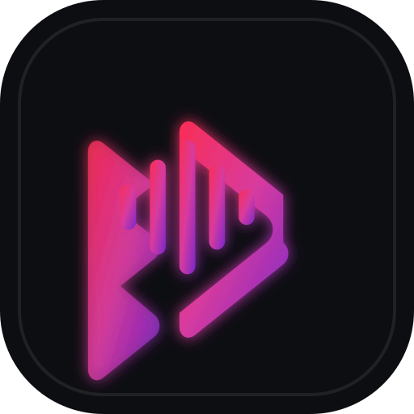

# 📼 Mixtape (PWA)

> Reproductor de música con auténtica estética **80s Rock Hi-Fi Cassette Deck**, pletina de casette giratoria sincronizada con tinta a bolígrafo escrita a mano en tiempo real, búsqueda sin límites, recomendaciones personalizadas basadas en tus gustos, canales continuos y soporte completo para **iPhone (iOS), Android, Windows y macOS**.



---

## ✨ Características Principales

1. **Estética 80s Rock & Hi-Fi Cassette Deck:**
   - Pletina de casette analógica con carretes giratorios sincronizados en bucle (`cinta.mp4`).
   - Simulación de caligrafía a bolígrafo azul tipo Bic que escribe letra por letra el título y artista sobre la cinta al reproducir cada canción.
   - Chasis con textura de metal anodizado cepillado, tornillería hexagonal de rack 19", vúmetros analógicos estéreo de LEDs (-20 a +3 dB) y contador mecánico de 4 dígitos.
   - Botonera mecánica clásica con pulsadores estilo deck (`[ ⏪ REW ]`, `[ ▶ PLAY ]`, `[ ⏸ PAUSE ]`, `[ ⏩ FF ]`).

2. **Recomendaciones Inteligentes y Colecciones Personalizadas:**
   - Algoritmo que analiza en tiempo real tus búsquedas, listas y canciones favoritas para recomendarte música en la pantalla principal.
   - **Colecciones Destacadas** personalizadas (Grandes Éxitos de los 80, Hard Rock & Heavy Metal Clásico, Baladas y AOR Legendario, etc.).
   - **Canales Continuos** con conciertos completos, directos míticos y sesiones de larga duración.

3. **Búsqueda Sin Límites:**
   - Múltiples fuentes combinadas (YouTube y Audius).
   - Sin restricciones de cantidad ni paginación forzada, con selector analógico de frecuencia y botón de carga rápida continua.

4. **100% Procesado en Local y Sin Anuncios:**
   - Todo el motor de reproducción, animaciones, base de datos local y lógica se ejecutan directamente en tu navegador o dispositivo.
   - No almacena archivos multimedia pesados en servidores; transmite audio directamente bajo demanda.

5. **Multiplataforma y PWA (iOS, Android, Windows, macOS):**
   - Soporte nativo para la API `navigator.mediaSession`: visualiza carátulas y controla pistas desde la pantalla de bloqueo de tu móvil, Dynamic Island, barra de notificaciones o teclado.
   - Caché local con **IndexedDB** para reproducción resistente a pérdidas de cobertura.

---

## 🚀 Inicio Rápido en Local

Para probar la aplicación en tu equipo:

```bash
# 1. Accede al directorio del proyecto
cd "D:\REPRODUCTOR MUSICA"

# 2. Inicia el servidor de desarrollo local
npm run dev
```

Abre tu navegador en `http://localhost:3030`.

---

## 📱 Cómo Instalar como PWA en tus Dispositivos

### En iPhone / iPad (iOS):
1. Abre la URL en **Safari**.
2. Toca el botón **Compartir** (icono de cuadrado con flecha hacia arriba).
3. Selecciona **"Añadir a la pantalla de inicio"** (Add to Home Screen).
4. Ábrela desde tu pantalla de inicio: funcionará como una app nativa a pantalla completa y con controles en la pantalla de bloqueo.

### En Android:
1. Abre la URL en **Chrome** o **Brave**.
2. Pulsa en el menú de los 3 puntos y selecciona **"Instalar aplicación"** o pulsa el banner que aparecerá abajo.

### En Windows y macOS:
1. Abre la URL en **Google Chrome**, **Microsoft Edge** o **Brave**.
2. Haz clic en el icono de instalación (pantalla con flecha) situado en la barra de direcciones superior derecha.
3. Se integrará como una app independiente en tu menú Inicio / Launchpad.

---

## ☁️ Conexión con Firebase (Opcional - Sincronización en la Nube)

1. Ve a [Firebase Console](https://console.firebase.google.com/) y crea un proyecto gratuito (**Plan Spark**).
2. Activa **Authentication** (habilita *Proveedor Anónimo* y/o *Google*).
3. Activa **Cloud Firestore** en modo de producción o prueba.
4. En la configuración del proyecto, añade una aplicación Web y copia el objeto JSON de configuración:
   ```json
   {
     "apiKey": "AIzaSy...",
     "authDomain": "tu-proyecto.firebaseapp.com",
     "projectId": "tu-proyecto",
     "storageBucket": "tu-proyecto.appspot.com",
     "messagingSenderId": "...",
     "appId": "..."
   }
   ```
5. En la app **Mixtape**, pulsa en **Ajustes** (icono de engranaje), pega el JSON y pulsa **Guardar Configuración**. ¡Tus listas quedarán sincronizadas automáticamente!

---

## 🌐 Publicación en GitHub Pages

Este proyecto ya incluye el flujo de trabajo automatizado de GitHub Actions en `.github/workflows/deploy.yml`.

Para subirlo y tenerlo publicado en internet de forma gratuita:

```bash
# Inicializa git
git init
git add .
git commit -m "Initial release of Pulse Music PWA"

# Vincula tu repositorio de GitHub (sustituye TU-USUARIO y TU-REPOSITORIO)
git branch -M main
git remote add origin https://github.com/TU-USUARIO/TU-REPOSITORIO.git
git push -u origin main
```

Una vez subido:
1. En tu repositorio en GitHub, ve a **Settings** > **Pages**.
2. En **Build and deployment** > **Source**, selecciona **GitHub Actions**.
3. En unos 60 segundos tu reproductor estará publicado y accesible en `https://TU-USUARIO.github.io/TU-REPOSITORIO/`.
